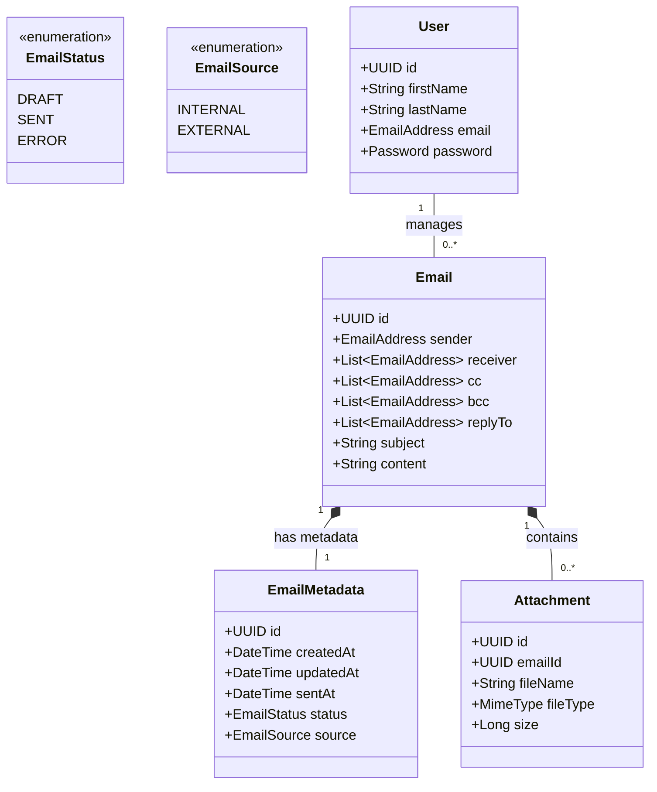

# Domain Model Documentation (`domain.md`)

This document presents the domain model, entity properties, UML representation, and business rules for the Web Technologies semester project, based on the project specification and architectural guidelines discussed in class.

---

## 1. Domain Objects & Properties

The domain is split into **Entities** (objects defined by their identity, e.g., UUID) and **Value Objects** (immutable objects defined by their attributes).

### 1.1 Value Objects / Custom Types
To avoid primitive obsession and ensure valid system states, standard primitive types are wrapped into domain-specific types:

- **`UUID`**: Universally Unique Identifier used as a surrogate identifier across domain objects.
- **`EmailAddress`**: String formatted according to RFC 5322 (e.g., `user@domain.com`).
- **`Password`**: Encrypted/hashed binary or string representation (e.g., Argon2/Bcrypt hash).
- **`MimeType`**: Standard media type identifier (e.g., `image/jpeg`, `application/pdf`, `text/plain`).
- **`DateTime`**: ISO 8601 timestamp with local time zone context.

---

### 1.2 Domain Entities & Aggregates

#### A. User
Represents an actor in the system. Since users can update their email addresses, a persistent surrogate ID (`UUID`) is used for identity resolution.

| Property | Type | Description |
| :--- | :--- | :--- |
| `id` | `UUID` | Unique identifier (Primary Key) |
| `firstName` | `String` | User's given name |
| `lastName` | `String` | User's family name (surname) |
| `email` | `EmailAddress` | Primary email address associated with the account |
| `password` | `Password` | Encrypted/hashed password |

#### B. Email (Aggregate Root)
Represents the core message data structure.

| Property | Type | Description |
| :--- | :--- | :--- |
| `id` | `UUID` | Unique identifier of the email |
| `sender` | `EmailAddress` | Sender's email address (`From`) |
| `receiver` | `List<EmailAddress>` | List of primary recipient email addresses (`To`) |
| `cc` | `List<EmailAddress>` | List of Carbon Copy recipients |
| `bcc` | `List<EmailAddress>` | List of Blind Carbon Copy recipients |
| `replyTo` | `List<EmailAddress>` | List of addresses to receive replies |
| `subject` | `String` | Message subject line |
| `content` | `String` | Plain-text body content |

#### C. EmailMetadata
Contains administrative and state metadata managed exclusively by the system.

| Property | Type | Description |
| :--- | :--- | :--- |
| `id` | `UUID` | Unique metadata ID (1:1 with Email ID) |
| `createdAt` | `DateTime` | Local timestamp of creation |
| `updatedAt` | `DateTime` | Local timestamp of last modification |
| `sentAt` | `DateTime?` | Optional timestamp of successful transmission |
| `status` | `EmailStatus` | Enum: `DRAFT`, `SENT`, `ERROR` |
| `source` | `EmailSource` | Enum: `INTERNAL` (sent), `EXTERNAL` (received) |

#### D. Attachment
Represents metadata of a binary file attached to an email. The actual binary content is stored in the underlying file system.

| Property | Type | Description |
| :--- | :--- | :--- |
| `id` | `UUID` | Unique attachment identifier |
| `emailId` | `UUID` | Reference to the associated Email |
| `fileName` | `String` | Original name of the uploaded file |
| `fileType` | `MimeType` | Media type of the binary payload |
| `size` | `Long` | File size in bytes |

---

## 2. UML Domain Model (Mermaid)

---

## 3. Business Rules & Validation Constraints

To ensure data integrity and prevent system abuse, the following business logic rules must be enforced during domain state transitions:

### 3.1 Email Creation & State Rules
1. **Recipient Constraint (Minimum Requirement):**
   - An email MUST contain **at least one** valid `EmailAddress` across the `receiver` (To), `cc`, or `bcc` fields combined.
   - $\text{size}(\text{receiver}) + \text{size}(\text{cc}) + \text{size}(\text{bcc}) \ge 1$

2. **Non-Empty Content Rules:**
   - `subject` must NOT be null, empty, or contain only whitespace characters.
   - `content` must NOT be null or empty. (Restricted to plain text format).

3. **Status Lifecycle:**
   - Newly created emails start with `status = DRAFT` and `sentAt = null`.
   - `createdAt` and `updatedAt` are initialized to the current server timestamp.
   - An email with status `SENT` becomes **immutable** (Read-Only). No updates or attachment modifications are permitted once sent.

### 3.2 Maximum Limits & System Constraints
1. **Recipients Limit:** Maximum 100 combined recipient addresses per email to prevent spamming.
2. **Subject Limit:** `subject` max length = **255 characters**.
3. **Content Limit:** `content` max length = **65,535 characters** (~64 KB plain text).
4. **Attachment Constraints:**
   - Maximum number of attachments per email: **10 files**.
   - Maximum size per individual file: **25 MB**.
   - Cumulative email size limit (content + attachments): **50 MB**.

### 3.3 Attachment Rules
1. **Immutability:** Existing attachments cannot be updated in-place. Modifying an attachment requires deleting the existing object and uploading a new one.
2. **Cascade Deletion:** Permanently deleting an email MUST remove all associated attachment records from the database and delete binary data from the file system.

---

## 4. Discussion & Comparison Notes

When comparing this model with peers, consider discussing the following key architectural choices:

1. **UUID vs. Auto-Incrementing Numeric ID:**
   - *Decision:* UUID is preferred for `User`, `Email`, and `Attachment` identifiers to decouple internal state generation from persistent storage and avoid predictable sequence numbers in REST APIs.
2. **Metadata Separation:**
   - *Decision:* Separating structural text (`Email`) from server-managed lifecycle metadata (`EmailMetadata`) clarifies domain boundaries and simplifies immutability checks on sent messages.