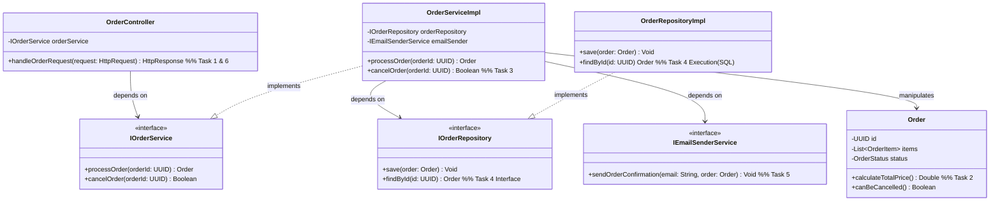

# System Architecture Documentation (`architecture.md`)

This document covers the C4 Model definition (Levels 1–3), Architecture Discussion responses, and the Refactoring Design for Section 4.

---

## 1. C4 Model Architecture (Structurizr DSL)

Below is the complete Structurizr DSL script representing the **Email System** across **Level 1 (System Context)**, **Level 2 (Containers)**, and **Level 3 (Components)**.

### 1.1 Structurizr DSL Code

```structurizr
workspace "Email System Architecture" "C4 Model up to Level 3 for Web Technologies Project" {

    model {
        user = person "User" "A person who creates, reads, updates, deletes, and sends emails."
        
        emailSystem = softwareSystem "Email Application System" "Allows users to manage and send plain-text emails with attachments." {
            
            webClient = container "Single-Page Web Application (Frontend)" "Provides the user interface for email management via browser." "React / TypeScript"
            
            backendApp = container "API Application (Backend)" "Handles business logic, validations, authentication, and email processing." "Java / Spring Boot" {
                
                // Layered Components inside Backend
                authController = component "Auth Controller" "Handles login, authentication HTTP endpoints." "REST Controller"
                emailController = component "Email Controller" "Exposes REST endpoints for email CRUD & send operations." "REST Controller"
                
                emailService = component "Email Service" "Implements email domain logic, validation, and status transitions." "Service Layer"
                attachmentService = component "Attachment Service" "Manages attachment file storage metadata and binary processing." "Service Layer"
                
                emailRepository = component "Email Repository Interface" "Data access contract for Email domain persistence." "Repository Interface"
                attachmentRepository = component "Attachment Repository Interface" "Data access contract for file metadata." "Repository Interface"
                
                smtpClient = component "SMTP / IMAP Client" "Integrates with external mail transfer protocols." "Integration Component"
            }
            
            database = container "Relational Database" "Stores users, emails, metadata, and attachment metadata." "PostgreSQL / MySQL" "Database"
            fileStorage = container "File System Storage" "Stores binary attachment payloads on disk." "Configurable File Path" "File System"
        }
        
        externalSmtp = softwareSystem "External Mail Server" "External SMTP/IMAP server for email delivery." "External System"

        # Relationships
        user -> webClient "Uses via Web Browser [HTTPS]"
        webClient -> emailController "Makes API calls to [HTTPS / REST JSON]"
        webClient -> authController "Authenticates via [HTTPS / REST JSON]"
        
        emailController -> emailService "Delegates business operations to"
        emailController -> attachmentService "Delegates attachment requests to"
        
        emailService -> emailRepository "Uses to persist email state"
        emailService -> smtpClient "Triggers email transmission via"
        attachmentService -> attachmentRepository "Uses to persist file metadata"
        attachmentService -> fileStorage "Reads/Writes binary payloads to"
        
        emailRepository -> database "Reads/Writes tabular data via [JDBC / ORM]"
        attachmentRepository -> database "Reads/Writes attachment metadata via [JDBC / ORM]"
        smtpClient -> externalSmtp "Sends and fetches email via [SMTP / IMAP]"
    }

    views {
        systemContext emailSystem "SystemContext" {
            include *
            autoLayout lr
        }

        container emailSystem "Containers" {
            include *
            autoLayout lr
        }

        component backendApp "Components" {
            include *
            autoLayout tb
        }

        styles {
            element "Software System" {
                background #1168bd
                color #ffffff
            }
            element "Person" {
                background #08427b
                color #ffffff
            }
            element "Container" {
                background #438dd5
                color #ffffff
            }
            element "Component" {
                background #85bbf0
                color #000000
            }
            element "Database" {
                shape Cylinder
            }
            element "File System" {
                shape Folder
            }
        }
    }
}
```

---

## 2. Architecture Review Checklist

* [x] **Three-Tier System Architecture:**
  1. **Presentation Tier:** Single-Page Web Application (Frontend Browser).
  2. **Application / Business Tier:** API Application (Java/Spring Boot REST Server).
  3. **Data Tier:** Relational Database & File System Storage.
* [x] **Layered Architecture in Applications:**
  * **Frontend:** UI Components $\rightarrow$ State Management / API Client.
  * **Backend:** Presentation Layer (`Controllers`) $\rightarrow$ Business Logic Layer (`Services`) $\rightarrow$ Data Access Layer (`Repositories`).

---

## 3. Architecture Discussion Questions & Answers

### Q1: What is the project paradox, and what is its key point?
* **Answer:** The *Project Paradox* (or Knowledge-Decision Paradox) states that at the beginning of a project—when we make the most critical architectural decisions—we have the **least knowledge** about the system, requirements, and domain. Conversely, when we finally have deep domain knowledge (at the end), decisions are hard and expensive to change.
* **Key Point:** Architecture must be designed to **defer decisions** and **isolate change**, allowing software to adapt as understanding grows.

### Q2: How are we trying to make changes easier? Can you see this in your C4 model?
* **Answer:** We make changes easier through **loose coupling**, **high cohesion**, and **clear separation of concerns** (using layered architecture and interface abstractions).
* **In the C4 Model:** In Level 3, the `EmailController` does not directly execute database queries or handle file I/O; it delegates to `EmailService`. The `EmailService` interacts with data via the `EmailRepository` interface rather than a rigid database implementation.

### Q3: Why does good architecture matter?
* **Answer:** Good architecture manages complexity, accelerates long-term development velocity, ensures maintainability, enforces security, and minimizes the cost of changing business requirements over time.

### Q4: Why do we need to understand the business domain and domain model?
* **Answer:** Software is built to solve business problems. Without a solid understanding of the domain, developer assumptions lead to misaligned data structures, invalid state logic, and heavy refactoring. A shared domain model creates a "ubiquitous language" between domain experts and software engineers.

### Q5: Can we introduce additional domain objects that were not included in the original domain description?
* **Answer:** **Yes.** Technical implementation details often require auxiliary domain objects, value objects, or enums (e.g., `EmailStatus`, `EmailSource`, `EmailAddress`, `MimeType`, `Password`) to preserve invariants, prevent "primitive obsession," and enforce business rules cleanly.

### Q6: What does each level of a C4 model show, and who is its intended audience?
1. **Level 1: System Context**
   * *Shows:* The system as a high-level box in its ecosystem, its users, and external software dependencies.
   * *Audience:* Non-technical stakeholders, business analysts, product managers, developers.
2. **Level 2: Container Diagram**
   * *Shows:* High-level runnable units/deployables (Web apps, API applications, databases, file stores) and technology choices.
   * *Audience:* Software architects, developers, operations/DevOps engineers.
3. **Level 3: Component Diagram**
   * *Shows:* Decomposed internal structure of a single container into logical components/modules, interfaces, and dependencies.
   * *Audience:* Software developers and architects.
4. **Level 4: Code Diagram** *(Optional)*
   * *Shows:* Low-level class/interface UML structure.
   * *Audience:* Developers working on specific code execution paths.

### Q7: What is a layered architecture, and what is its purpose?
* **Answer:** Layered architecture organizes code into horizontal layers, where each layer has a distinct responsibility (e.g., Presentation, Business Logic, Data Access).
* **Purpose:** It isolates concerns so that changes in one layer (e.g., changing the database from MySQL to PostgreSQL or changing UI frameworks) do not cascade into or break other layers.

### Q8: Which component is responsible for displaying an email to the user?
* **Answer:** The **Single-Page Web Application (Frontend UI Component)** running in the client browser. It fetches JSON email payloads from the backend API and renders them visually in the user interface.

---

## 4. Refactor a Use Case: `OrderController`

### 4.1 Original Responsibilities Analysis
The monolithic `OrderController` previously handled 6 distinct tasks. We refactor these across a layered 3-tier structure:

| # | Task | Assigned Layer | Assigned Class / Interface |
|---|---|---|---|
| 1 | Receives an HTTP request | Presentation Layer | `OrderController` |
| 2 | Calculates the total price | Business Domain Layer | `Order` (Domain Model) / `OrderCalculationService` |
| 3 | Checks whether order may be cancelled | Business Logic Layer | `OrderService` |
| 4 | Executes an SQL statement | Data Access Layer | `OrderRepository` (Data Access Object) |
| 5 | Sends a confirmation email | Infrastructure / Integration | `EmailNotificationService` |
| 6 | Creates the HTTP response | Presentation Layer | `OrderController` |

---

### 4.2 Class & Dependency Architecture Diagram

```
+-----------------------------------------------------------------------+
|                          PRESENTATION LAYER                           |
|                                                                       |
|   +---------------------------------------------------------------+   |
|   |                       OrderController                         |   |
|   +---------------------------------------------------------------+   |
|   | Handles tasks (1) Receive Request & (6) Create HTTP Response. |   |
|   +-------------------------------+-------------------------------+   |
+-----------------------------------|-----------------------------------+
                                    |
                                    v (uses interface)
+-----------------------------------------------------------------------+
|                          BUSINESS LOGIC LAYER                         |
|                                                                       |
|   +---------------------------------------------------------------+   |
|   |                       IOrderService (Interface)               |   |
|   +---------------------------------------------------------------+   |
|                                   ^                                   |
|                                   | (implements)                      |
|   +-------------------------------+-------------------------------+   |
|   |                        OrderServiceImpl                       |   |
|   +---------------------------------------------------------------+   |
|   | Handles task (3) Check cancellation rules & coordinates flow. |   |
|   +------------+-----------------------------------+--------------+   |
+----------------|-----------------------------------|------------------+
                 |                                   |
                 v (uses domain)                     v (uses interface)
+----------------------------------+   +--------------------------------+
|          DOMAIN LAYER            |   |      INFRASTRUCTURE LAYER      |
|  +----------------------------+  |   |  +--------------------------+  |
|  |           Order            |  |   |  |   IEmailSenderService    |  |
|  +----------------------------+  |   |  +--------------------------+  |
|  | Task (2): Calculate Total  |  |   |  | Task (5): Send Email     |  |
|  +----------------------------+  |   |  +--------------------------+  |
+----------------------------------+   +--------------------------------+
                 |
                 v (uses interface)
+-----------------------------------------------------------------------+
|                         DATA ACCESS LAYER (DAL)                       |
|                                                                       |
|   +---------------------------------------------------------------+   |
|   |                     IOrderRepository (Interface)              |   |
|   +---------------------------------------------------------------+   |
|                                   ^                                   |
|                                   | (implements)                      |
|   +-------------------------------+-------------------------------+   |
|   |                      OrderRepositoryImpl                      |   |
|   +---------------------------------------------------------------+   |
|   | Task (4): Executes SQL statements against database.           |   |
|   +---------------------------------------------------------------+   |
+-----------------------------------------------------------------------+
```

### 4.3 Detailed UML Class Diagram (Mermaid)

